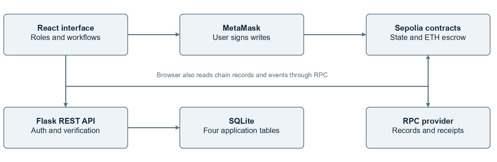
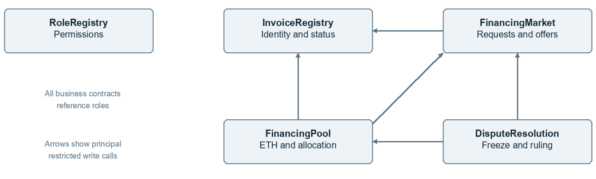
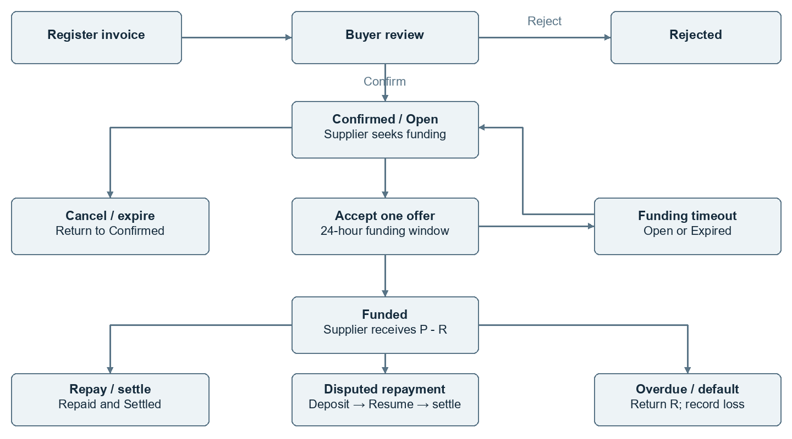
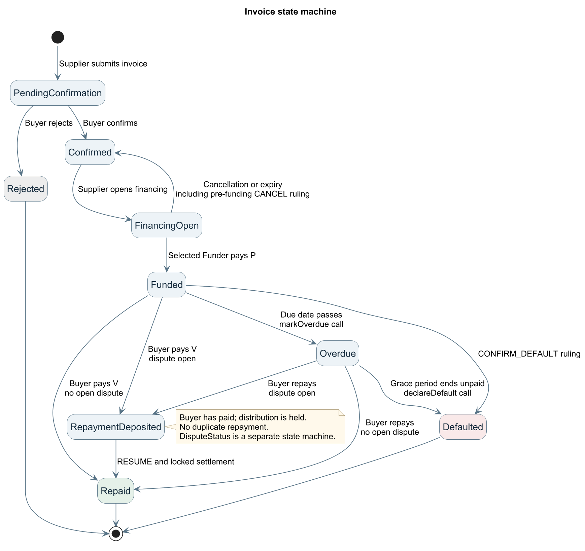
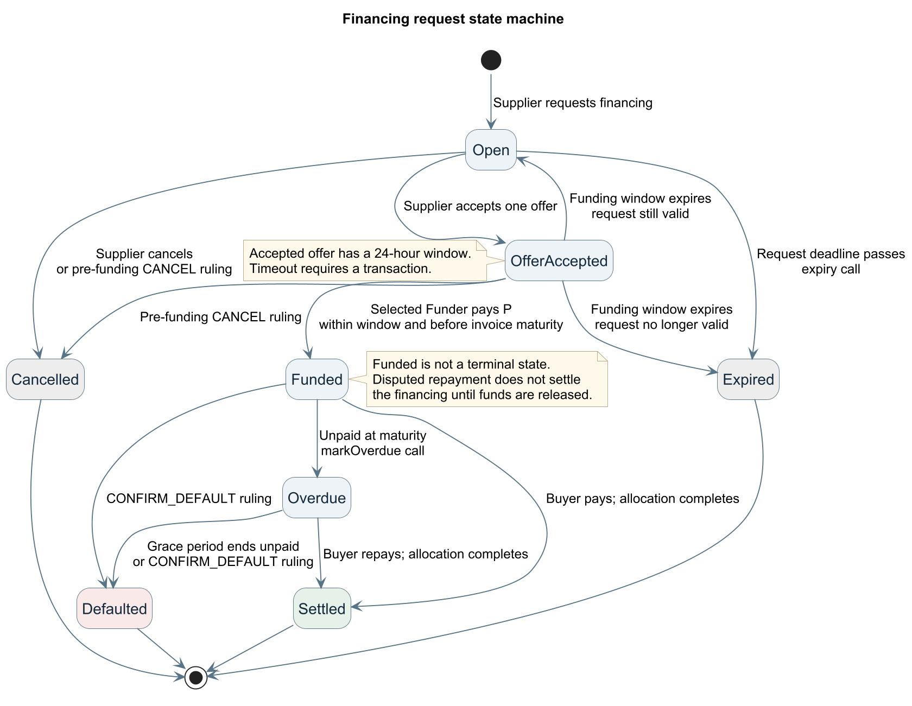
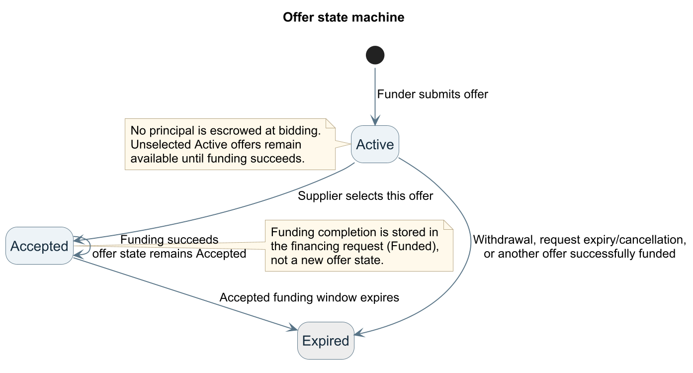
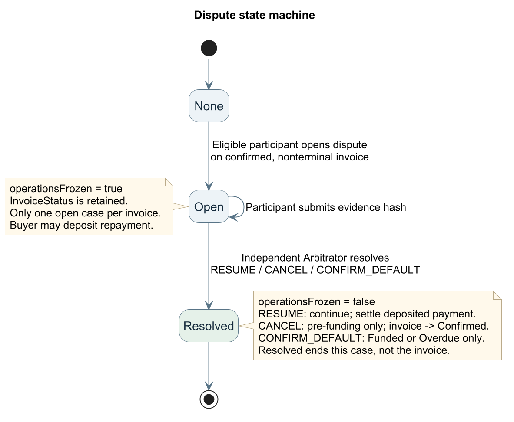
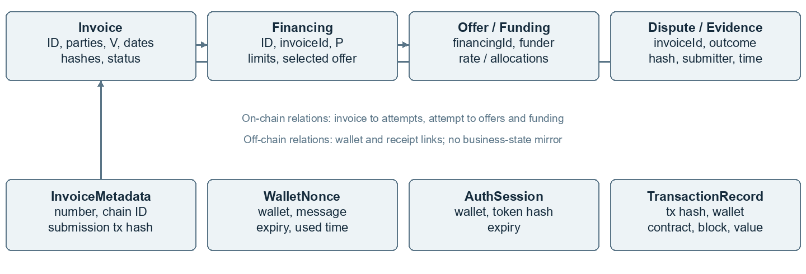
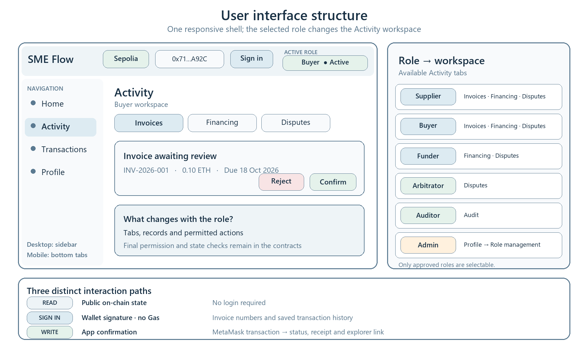

# SME Receivables Financing

*SC6113 Group Project Technical Report*

## Executive summary

SME Flow connects suppliers, buyers and funders through a buyer-confirmed receivable and a shared set of financing rules. Five interacting smart contracts govern roles, invoices, quotations, escrow and dispute resolution. A mobile-first React interface supports wallet signing, while Flask and SQLite provide authentication, supplementary metadata and verified transaction records. This report explains the business problem, technical architecture, security controls and financial logic, and evaluates the solution through a reproducible financing scenario. The architecture, process, four state machines, data model and user-interface diagrams document the complete workflow.

## 1 Real-World Problem and Requirements

### 1.1 Financing problem and evidence

An SME supplier can complete a sale before receiving the buyer’s payment. During that interval, it still needs cash to pay employees, acquire materials and fulfil new orders. Financing the receivable can release working capital earlier, but a funder must establish that the buyer recognises the obligation, understand the terms and follow the allocation of repayment. When participants hold separate records, they must reconcile invoice identity, approval, financing status and payment history.

The Asian Development Bank’s December 2025 Global Trade Finance Gap Survey estimates unmet global trade-finance demand at US$2.5 trillion, drawing on responses from more than 110 providers. It identifies trade digitalisation and supply-chain finance linked to anchor buyers as relevant responses [4]. This is evidence of the broader financing problem; SME Flow addresses the specific coordination and auditability needs of a supplier, its buyer and a prospective funder.

### 1.2 Stakeholders and existing workflow

| **Stakeholder** | **Business need** | **Project response** |
| --- | --- | --- |
| Supplier | Liquidity before the invoice matures | Submit a receivable, compare quotations and receive an advance |
| Buyer | Verify the obligation and track payment | Confirm or reject the invoice and repay the stated face value |
| Funder | Assess terms and follow the use of funds | Quote a rate and inspect funding, return and loss records |
| Admin | Govern participation | Approve and revoke wallet roles |
| Arbitrator | Resolve disagreements consistently | Review evidence hashes and choose a stage-compatible ruling |
| Auditor | Reconstruct the business and cash-flow history | Read states, events, allocations and transaction receipts |

In a conventional workflow, a supplier submits documentation, a buyer confirms the obligation and a financing provider makes an advance. Each institution may maintain its own status and transaction records. A central platform can coordinate these activities efficiently when all participants accept its operator. SME Flow makes confirmation, the selected funding commitment and the programmed allocation visible through the same contract state, so participants can reconcile their actions against a common record.

### 1.3 Suitability of blockchain

Blockchain is appropriate here because several parties need a shared transaction history and enforceable rules without giving one application database control over the financial state. Each wallet authorises its own actions; contracts enforce permissions, exact payment amounts and state transitions; and events make the sequence independently inspectable. This follows the shared, tamper-evident ledger model described by NIST [5]. Buyer confirmation supplies an accountable acknowledgement of the invoice, while document hashes link that acknowledgement to off-chain business evidence. Role approval and the designated arbitrator make the project’s trust relationships explicit.

### 1.4 Functional and quality requirements

The functional requirements are approved wallet roles, invoice submission and buyer confirmation, financing requests, competing quotations, selection of one funder, escrow-based funding, repayment, dispute handling and read-only audit access. The five-contract design and the 18 representative transactions in Section 3 implement this workflow. Flask REST services and persistent SQLite records support the interface without taking custody of private keys.

Security requirements include participant and state checks, protection against repeated transfers, verified transaction recording and expiring wallet sessions. Usability requirements include mobile layouts, visible amounts and next actions, gas estimates and understandable transaction feedback. Maintainability is supported by separated contracts, published interfaces and ABI files, and documented setup. Success indicators are funding availability, allocation accuracy, workflow completion, gas cost, traceability and role-specific task clarity; Section 7 defines their measurement and applies the financial model to the documented scenario.

## 2 System architecture

### 2.1 Architecture and technology selection

*Figure 1. System architecture. Contracts hold business state and ETH; SQLite stores authentication, metadata and verified transactions.*

SME Flow is a mobile-first receivables-financing Web DApp. The design uses React 19, Vite 8 and Mantine 9 for the responsive English-language interface; MetaMask and Ethers.js 6 provide wallet connection, signing and contract calls. Solidity 0.8.20 and OpenZeppelin Contracts implement the Sepolia contracts, with Remix IDE used for compilation, deployment and ABI generation. Python, Flask and Flask-SQLAlchemy provide REST services backed by SQLite. Git and GitHub retain source, ABI and deployment records [1–3].

The blockchain is the authoritative store for approved roles, invoice identity, business state, escrowed funds and arbitration outcomes. SQLite stores one-use login nonces, expiring sessions, invoice-number metadata and verified transaction history; it does not mirror financing, offers, payments, disputes or event state. The current design stores hashes rather than original invoice, contract or evidence files. The frontend prepares financial calls, but MetaMask signs them and contracts enforce permissions and transitions. The backend independently verifies receipts through RPC.

### 2.2 Functional module decomposition

| **Module** | **Primary responsibility** | **Main implementation** |
| --- | --- | --- |
| Identity and governance | Wallet authentication, role applications, approval and revocation | RoleRegistry, Flask authentication and Admin workspace |
| Invoice lifecycle | Invoice registration, protected business metadata, Buyer confirmation or rejection and lifecycle status | InvoiceRegistry, invoice metadata API and Supplier/Buyer workspaces |
| Financing marketplace | Financing requests, competing quotations, offer selection, cancellation and timeout handling | FinancingMarket and Supplier/Funder workspaces |
| Funds and settlement | Principal funding, holdback, repayment, allocation, overdue marking and default accounting | FinancingPool and payable wallet transactions |
| Dispute resolution | Case creation, evidence hashes, operation freeze, repayment escrow and predefined rulings | DisputeResolution and Buyer/Arbitrator workspaces |
| Audit and traceability | Receipt verification, transaction history, event timelines and cash-flow reconstruction | RPC event reads, Flask verification services and Auditor workspace |

The modules share identifiers and contract interfaces but retain separate responsibilities. This separation keeps role governance, invoice state, financing competition, fund custody and arbitration independently auditable while presenting them as one end-to-end workflow in the interface.

### 2.3 Runtime and settlement scope

The documented runtime combines Flask and Vite with Sepolia contracts. Backend execution and the frontend API proxy use port 61133. Native Sepolia test ETH represents invoice value, principal, holdback, interest and platform fees, with integer wei accounting. Section 8 records the configured contract addresses and deployment sequence.

## 3 Smart contract design and interaction

*Figure 2. Contract dependencies. RoleRegistry supplies authorization, InvoiceRegistry owns invoice status, and other contracts use restricted interfaces.*

### 3.1 Contract responsibilities

| **Contract** | **Responsibility** | **Important relationship** |
| --- | --- | --- |
| RoleRegistry | Requests, approval and revocation of roles | Shared authorization source |
| InvoiceRegistry | Invoice identity and core lifecycle | Accepts status changes only from configured operators |
| FinancingMarket | Financing requests, offers and acceptance | Updates invoice state; receives pool and dispute callbacks |
| FinancingPool | Funding, retained proceeds, repayment and default | Updates market and invoice states before checked payouts |
| DisputeResolution | Cases, hashes, freezes and rulings | Can cancel a request or trigger permitted pool outcomes |

InvoiceRegistry owns the unique invoice record and is the sole storage and update entry point for InvoiceStatus. The design derives invoiceKey from Buyer, Supplier, invoice number, issue date and chain ID. Duplicate keys are rejected; confirmed core fields cannot be changed. Only registered FinancingMarket, FinancingPool and DisputeResolution contracts may perform their permitted cross-contract status transitions. One invoice can have only one active financing attempt. Cancellation or expiry returns it to Confirmed and permits a new attempt; Repaid and Defaulted records cannot be refinanced.

### 3.2 Transaction coverage

The table lists 18 representative state-changing transaction types, covering role onboarding, invoice confirmation, financing, offers, payment, default and disputes. Additional administrative and timeout functions support operation of the contracts. Read-only queries and wallet authentication signatures are not counted as blockchain transactions.

| **No.** | **Method** | **Caller and business effect** |
| --- | --- | --- |
| 1 | requestRole | Any wallet requests a participant role |
| 2 | approveRole | Admin approves a role |
| 3 | submitInvoice | Supplier registers invoice details and hash |
| 4 | confirmInvoice | Designated Buyer confirms |
| 5 | rejectInvoice | Designated Buyer rejects |
| 6 | openFinancing | Supplier requests financing on a confirmed invoice |
| 7 | cancelFinancing | Supplier cancels before accepting an offer |
| 8 | submitOffer | Funder quotes within the maximum rate |
| 9 | withdrawOffer | Funder withdraws its active offer |
| 10 | acceptOffer | Supplier selects one active quote |
| 11 | fundFinancing | Selected Funder transfers exactly P |
| 12 | repayInvoice | Buyer transfers exactly V |
| 13 | finalizeSettlement | Any caller finalizes unfrozen deposited repayment |
| 14 | markOverdue | Authorized participant marks an unpaid overdue invoice |
| 15 | declareDefault | Authorized participant declares default after the grace period |
| 16 | openDispute | Supplier, Buyer or relevant Funder opens a case |
| 17 | submitEvidenceHash | Case participant submits evidence hash |
| 18 | resolveDispute | Independent Arbitrator chooses a compatible ruling |

Multiple Funders may quote, but Supplier accepts only one offer before financingDeadline. Unselected offers remain Active as alternatives until funding succeeds, when they expire. The selected Funder has a 24-hour funding window even if it extends beyond the request deadline; actual funding must still precede invoice maturity. If selection times out, the accepted offer expires: the request returns to Open if still valid, otherwise it becomes Expired. No principal is locked during bidding.

### 3.3 Role separation and conflict checks

RoleRegistry maps each wallet to multiple approved roles rather than a single role enum. Role state is Inactive, Pending or Active, with approval and revocation controlled by Admin. Admin and Arbitrator are separate responsibilities, and the Auditor role grants no business write authority. Per invoice, Supplier and Buyer must differ; Funder cannot be Supplier; Arbitrator cannot be a participant. New role-gated actions require active approval. Existing commitments are completed through the recorded party addresses where specified in the design, so role selection in the interface does not replace contract checks.

### 3.4 Gas efficiency and bounded operations

The contracts keep original invoices and evidence files off chain and store only fixed-size hashes and the fields required for settlement. Mappings provide direct access to primary records, while SQLite avoids duplicating authoritative financing and payment state. FinancingMarket limits each request to 20 offers, which bounds the loop used to expire remaining offers when a request closes or funding succeeds. The interface estimates gas and the network fee before signature so users can review transaction cost. Detailed gasUsed and effectiveGasPrice measurements belong with the execution evidence and are not repeated in this report.

## 4 Business process and exceptional paths

*Figure 3. Design process showing rejection, failed funding, normal repayment, disputed repayment and default. Timeout and settlement transitions require contract calls.*

### 4.1 Main process

After wallet authentication and role approval, Supplier submits the Buyer address, invoice number, face value, issue date, due date and document hash. Buyer confirms or rejects the PendingConfirmation invoice. Confirmation locks the record and allows Supplier to create an Open financing request with principal P, maximum annual rate maxRateBps, holdbackBps and financingDeadline. Supplier may cancel before accepting an offer; an unselected request can expire. Both exits return the invoice to Confirmed. Buyer rejection produces the Rejected terminal state.

The selected Funder calls payable fundFinancing with msg.value exactly equal to P. FinancingPool retains holdback R and pays Supplier P - R; invoice and financing become Funded. Buyer later calls payable repayInvoice with exactly the face value V. Without a dispute, the same transaction allocates principal and interest to Funder, fee F to the platform and the remainder to Supplier. Invoice becomes Repaid and financing becomes Settled. Incorrect incoming amounts or failed checked ETH transfers revert the transaction.

### 4.2 Disputed repayment

Supplier, Buyer or the relevant Funder may open a dispute on a confirmed, nonterminal invoice and submit a reason hash. DisputeStatus becomes Open and operationsFrozen becomes true without replacing InvoiceStatus. Participants may add evidence hashes with submitter and timestamp. Buyer may still repay: funds remain in escrow and the invoice becomes RepaymentDeposited. Duplicate repayment and ordinary settlement are prohibited while the dispute is open. In the implemented RESUME path, resolveDispute clears the freeze and invokes FinancingPool.finalizeSettlement within the ruling transaction. The callable settlement function applies the locked allocation, without arbitrary recipients or amounts.

An approved Arbitrator who is not Supplier, Buyer or Funder in this invoice selects only RESUME, CANCEL or CONFIRM_DEFAULT. RESUME restores the underlying nonterminal workflow and enables normal allocation if payment has been deposited. CANCEL is limited to the pre-funding stage, expires the current offers and returns the invoice to Confirmed. CONFIRM_DEFAULT is limited to Funded or Overdue and executes the specified holdback return and loss accounting. Resolved is the dispute terminal state, rather than an invoice terminal state.

### 4.3 Nonpayment and closure

An authorized participant marks an unpaid invoice Overdue after maturity. Repayment during the grace period still follows the ordinary allocation. If the grace period expires without payment, declareDefault returns retained R to Funder, records PrincipalLoss = P - R, UnpaidInterest = I and TotalUnpaidExposure = P - R + I, and moves invoice and financing to Defaulted. These are audit records; the contract cannot debit Buyer forcibly. This creates a final on-chain record of the unpaid exposure for the participating parties.

Business closure means each attempt has a defined exit and a defined allocation of its funds. Normal settlement and default must leave no escrow attributable to that financing; the shared pool may still hold funds for other active invoices. Expiry, overdue marking, default and arbitration require transactions, so elapsed time alone does not execute them. The design supplies explicit exits for refusal, cancellation, timeout and disputes without guaranteeing automatic completion in the absence of callers.

### 4.4 Independent state machines

The four diagrams describe the independent state machines used by the implementation. An arrow denotes a permitted transaction-triggered transition, not an automatic timer. Grey states end rejected, cancelled or expired workflows; green states indicate successful completion; red states indicate default. Dispute status is independent of invoice and financing status. Each diagram describes one record; resolving one case does not terminate its underlying invoice.

*Figure 4a. Invoice lifecycle, including rejection, cancellation, disputed repayment, overdue payment and default.*

*Figure 4b. Financing lifecycle. A selected-offer timeout reopens a valid request or expires an invalid one; Funded remains intermediate.*

*Figure 4c. Offers use only Active, Accepted and Expired. Successful funding leaves the selected offer Accepted and updates the financing record.*

*Figure 4d. Evidence submission does not add a new dispute state. Only a compatible predefined ruling resolves the case and clears the freeze.*

## 5 Data model and backend services

*Figure 5. Data model. On-chain business identifiers link to supplementary SQLite records; business state and events are not mirrored in the database.*

### 5.1 On-chain data

Invoice records contain invoiceKey, Supplier, Buyer, invoice-number hash, document hash, face value, issue and maturity dates, and InvoiceStatus. Financing records reference Invoice ID and contain principal, rate ceiling, holdback, deadline, selected offer and financing state. Offers identify their financing request, Funder and quoted rate; the referenced financing record supplies the principal. Funding allocations retain actual Funder, funding time, maturity, locked interest, fee, retained proceeds and settlement/default accounting. Disputes reference the invoice and store case status, reason hash, evidence hashes, submitters, times and permitted outcome. The active dispute link determines whether related operations are frozen.

Invoice ID and financing ID connect the contracts; events associate transitions with participants, values and transaction hashes. Historical attempts remain distinct from the current attempt. The design uses a nontransferable registry record rather than an NFT. Every core transition emits an event so Auditor can reconstruct the invoice timeline and financial allocations independently.

### 5.2 Off-chain storage

| **Model** | **Stored information** | **Purpose** |
| --- | --- | --- |
| wallet_nonce | wallet_address, nonce, message, expires_at, used_at, created_at | One-use signed-login challenge |
| auth_session | wallet_address, token_hash, expires_at, created_at | Expiring authenticated session |
| invoice_metadata | supplier, buyer, invoice_number, face_value_wei, issued_at, due_at, document_hash, onchain_invoice_id, submit_tx_hash | Metadata and verified chain binding |
| transaction_record | chain_id, tx_hash, wallet_address, contract_name, action, value_wei, status, block_number, created_at | Verified wallet transaction history |

SQLite contains four tables: wallet_nonce, auth_session, invoice_metadata and transaction_record. Amounts are stored as wei strings, never floating-point values. EIP-191 personal-sign authentication verifies the recovered wallet against a one-use, expiring nonce. Sessions use random expiring tokens; the database stores only token hashes. Protected routes check the session, then the relevant on-chain role and resource ownership. Private keys are never stored by the frontend, backend or database.

### 5.3 API and integrity

Transaction verification queries the RPC receipt and checks its success status, sender and target contract before saving hash, action, value and block number. Invoice creation additionally parses InvoiceSubmitted and compares its metadata before binding the saved business number to the on-chain Invoice ID. Supplier and the designated Buyer may read their relevant metadata; an active Auditor may read all metadata. Live invoice, financing and offer queries are permission filtered and marked live-rpc.

Document and evidence hashes provide compact references to the underlying business material. Role applications, disputes and audit events are accessed directly through contracts; REST services provide authenticated metadata access and receipt verification alongside user-signed financial transactions. This separation keeps authoritative financial state on chain and supplementary application data in SQLite.

### 5.4 REST API responsibilities

| **Method** | **Endpoint** | **Purpose** |
| --- | --- | --- |
| GET | /api/health; /api/config | Health and published chain/contract configuration |
| POST | /api/auth/nonce; /api/auth/verify | Issue nonce and verify personal-sign login |
| GET | /api/auth/me | Current signed-in wallet |
| POST / GET | /api/invoices/metadata | Create and permission-filter metadata |
| GET | /api/invoices; /api/invoices/{id} | Live invoice list and details |
| GET | /api/financing-requests; /api/financing-requests/{id} | Live request list and details |
| GET | /api/financing-requests/{id}/offers | Request quotations |
| POST | /api/transactions/verify | Verify receipt and bind invoice ID when relevant |
| GET | /api/transactions | Signed-in wallet verified history |

## 6 User interface security and verification

*Figure 6. Responsive interface structure. The selected role controls the Activity workspace, while public reads, wallet-signature login and state-changing transactions follow separate paths.*

### 6.1 Mobile-first workspaces and audit

The primary interface is a responsive English-language Web DApp for the MetaMask mobile browser, with desktop access for auditing and administration. Shared controls show network, wallet, balance, approved roles, signature prompts, transaction progress and Etherscan links. The frontend landing page presents SME Flow, a Sepolia badge and Home, Activity, Transactions and Profile navigation.

Supplier views show confirmation requests, financeable invoices, quote comparisons, received funds and holdback. Buyer views show confirmation/rejection, amounts due, overdue warnings and repayment history. Funder views show opportunities, quotations, selected funding, expected and realized returns, principal loss and unpaid interest. Arbitrator views show current stage, reason and evidence hashes, submitters and only stage-compatible rulings. Admin approves or revokes roles. Auditor sees read-only status distributions, cash-flow allocations, disputes, events and transaction links.

### 6.2 Transaction feedback and audit integrity

Financial actions require an application confirmation followed by MetaMask signing. Transaction review presents the target contract, business value and estimated gas; errors distinguish rejected signatures, network failures, insufficient balance and contract reverts. Available actions depend on role, participation and state, with final enforcement on chain. Auditor reads current state through RPC and scans events in block segments from deployment, caching deployment blocks and timestamps within the browser session. Explorer links support independent receipt checks. This is a live audit view, not a durable backend event index.

### 6.3 Security controls

The security design combines role, participation and state checks; exact payable amounts; checked ETH call transfers; ReentrancyGuard; and Checks-Effects-Interactions [1, 2]. It rejects repeat funding, repayment and settlement. Cross-contract status writes are restricted to registered contracts, and Arbitrator cannot set arbitrary beneficiaries or amounts. Backend controls include expiring nonces and hashed sessions, parameterized queries, unique constraints, uniform error responses and independent receipt verification.

## 7 Evaluation and Measurable Impact

### 7.1 Evaluation scenario

The evaluation uses one coherent business case with separate Supplier, Buyer, Funder and Arbitrator wallets. The invoice face value is 0.05 ETH, the financing principal is 0.04 ETH, the holdback rate is 10% and the annual quotation is 6%. The scenario proceeds through invoice confirmation, offer acceptance, funding, a dispute, repayment into escrow, a RESUME ruling and audit review. It therefore connects stakeholder actions, contract transitions and cash flows in a single end-to-end case.

| **Evaluation dimension** | **Scenario outcome** | **Business significance** |
| --- | --- | --- |
| Working-capital access | Supplier receives an advance before Buyer repayment | Converts a confirmed receivable into earlier liquidity |
| Risk allocation | Part of the principal remains as holdback | Provides a predefined buffer against nonpayment |
| Disputed payment | Buyer can deposit the full repayment while allocation is frozen | Preserves the payment obligation without prejudging the dispute |
| Settlement integrity | Contract formulas allocate the deposited funds without an unexplained residual | Reduces manual reconciliation between participants |
| Default transparency | Returned holdback, principal loss and unpaid interest are recorded separately | Makes the Funder's unpaid exposure explicit and auditable |

### 7.2 Funding and settlement calculations

Let V be invoice face value, P the principal, h the holdback rate, r the annual rate in basis points, f the platform fee in basis points, and D the remaining days at funding rounded upward. The contract uses integer wei arithmetic. It locks R = floor(P × h / 10,000), I = floor(P × r × D / 10,000 / 365), and F = floor(P × f / 10,000). The supplier receives P − R at funding. On repayment, the funder receives P + I, the treasury receives F, and the supplier receives V + R − P − I − F.

For the documented case, R = 0.004 ETH and the immediate supplier receipt is 0.036 ETH. The requested principal is 80% of face value; the actual immediate liquidity is 72% after holdback. The retained amount is 10% of principal. If the financing term is an illustrative 30 days, the 6% quote gives approximately 0.000197260274 ETH interest. The actual interest and fee are read from the funding record because they depend on the funding time and configured fee rate.

The allocation conserves funds: (P + I) + F + (V + R − P − I − F) = V + R. Including the supplier’s initial P − R receipt, total distributed funds equal P + V, exactly the principal and repayment entering the workflow. If default occurs instead, returning R gives the funder 0.004 ETH and records principal loss of 0.036 ETH plus unpaid locked interest. These calculations explain both the liquidity benefit and the financial meaning of the default record; gas is accounted for separately.

### 7.3 Measurable impact

| **Indicator** | **Scenario result** | **Interpretation** |
| --- | --- | --- |
| Financing ratio | P / V = 80% | Share of the invoice financed |
| Immediate liquidity | (P − R) / V = 72%, or 0.036 ETH | Invoice value released before Buyer repayment |
| Early-liquidity gain versus waiting for repayment | 0.036 ETH before maturity instead of 0 ETH | Additional cash available to the Supplier during the payment interval |
| Retained protection | R / P = 10%, or 0.004 ETH | Principal retained as the contractual risk buffer |
| Settlement accuracy | Allocated amount − (V + R) = 0 | No unexplained residual for the settled financing |
| Default principal exposure | P − R = 0.036 ETH | Principal remaining at risk after the holdback is returned |
| Repayment custody during dispute | 100% of V remains in escrow until resolution | Buyer payment is preserved while distribution is frozen |

The comparison baseline assumes that the Supplier waits for the Buyer to pay the invoice and therefore receives no cash during the intervening period. These results quantify the liquidity, reserve and accounting effects of the implemented financial model without claiming a measured reduction in commercial processing time or financing cost beyond the evaluated scenario. Transaction cost is treated separately from the financial allocations; Section 3.4 summarises the design choices used to limit unnecessary on-chain work, while detailed execution measurements remain part of the testing record.

## 8 Deployment and Practical Feasibility

### 8.1 Repository and deployment configuration

The public Web DApp is available at https://sme.wuziran.fun/. The deployed frontend communicates with the Flask REST API for authentication, metadata and receipt verification, reads live contract state and events through a Sepolia RPC provider, and sends state-changing transactions to MetaMask for user approval. The project repository is https://github.com/GeraltWu/blockchain-sme-receivables-financing. It contains contract sources and interfaces, ABI artifacts, backend routes and tests, frontend pages, environment examples, setup instructions, design documentation and a user manual. The environment examples specify the following Sepolia targets; chain ID 11155111 is used for network selection.

| **Contract** | **Configured Sepolia address** |
| --- | --- |
| RoleRegistry | 0x7Ca082f5D846CF17A98D3de74948bd252c4C95E8 |
| InvoiceRegistry | 0xABA2fd723372C6E8d66C387770353a7eAD1C2784 |
| FinancingMarket | 0x47818B1e24df8E99d10F5BAf0dA5d59Cd88C2974 |
| FinancingPool | 0x729b397cD11216f5d61CF5Ea84d8AcC710DA9dAa |
| DisputeResolution | 0x361c6C2222396C81B578689e6887F144504821e1 |

The deployment order follows dependencies: RoleRegistry, InvoiceRegistry, FinancingMarket, FinancingPool and DisputeResolution. Admin then configures the permitted operators, pool and dispute-resolution references, and the five addresses are copied into frontend and backend configuration. Keeping contract addresses, ABI versions and compiler settings together supports reproducibility. The backend serves health and configuration routes; the frontend uses the configured RPC, wallet provider and API connection.

### 8.2 Practical adoption and responsible operation

The project combines competing quotations with buyer confirmation, explicit holdback, restricted arbitration and a shared audit trail. Its practical contribution is the integration of the full receivable lifecycle, including payment disagreements and unpaid exposure, into one understandable workflow. The responsive interface supports mobile participants while dedicated audit and administration views serve oversight needs.

Responsible adoption requires verified business identities, evidence linking each invoice to a genuine obligation, clear consent for disclosed metadata and an agreed process for appointing arbitrators. Any live financing arrangement also needs jurisdiction-specific review of receivable assignment, financial-service obligations and data protection. Hash-based document references and separated permissions support this operating model. Public-chain transaction costs, confirmation times and RPC availability should be considered when setting service expectations; event queries are segmented by block range and cached in the browser to support the audit experience.

The current deployment is appropriate for a prototype and controlled evaluation rather than high-volume production. Its main scaling limits are dependence on a public RPC provider, browser-side historical event scans, single-node SQLite storage and the deliberate 20-offer cap per financing request. A production extension could use a managed relational database, a persistent event indexer, a managed RPC service and server-side caching without changing the core contract state machines or settlement rules.

## 9 Conclusion

SME Flow provides an integrated receivables-financing DApp with six stakeholder roles, five interacting contracts and a complete path from invoice acknowledgement to funding, repayment and audit. The technical design separates authoritative financial state from supplementary backend records, while role checks and state machines govern both ordinary and exceptional actions. The financial scenario quantifies immediate liquidity and demonstrates allocation consistency. Together, the architecture, implementation and scenario-based evaluation explain how the system supports accountable financing and transparent settlement.

## References

[1] Solidity documentation. *Security Considerations*. https://docs.solidity.org/en/latest/security-considerations.html

[2] OpenZeppelin documentation. *Contracts 5.x Utilities and ReentrancyGuard*. https://docs.openzeppelin.com/contracts/5.x/api/utils#ReentrancyGuard

[3] Pallets Projects. *Flask Deploying to Production*. https://flask.palletsprojects.com/en/stable/deploying/

[4] Asian Development Bank. *ADB Global Trade Finance Gap Survey*. December 2025. https://www.adb.org/publications/adb-global-trade-finance-gap-survey

[5] National Institute of Standards and Technology. *Blockchain Technology Overview*. NIST IR 8202, 2018. https://csrc.nist.gov/pubs/ir/8202/final
